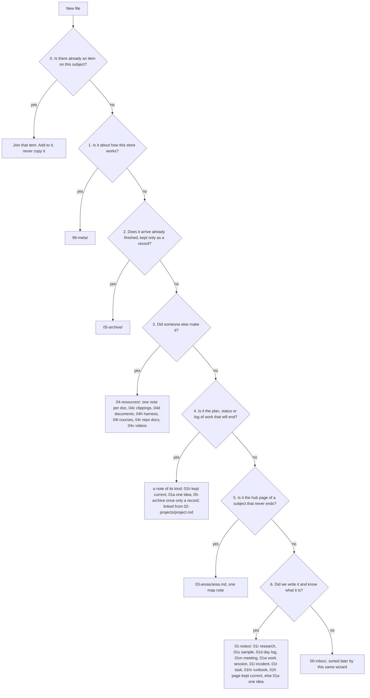

# INPARA organization standard

Version 1.23. This is the public copy of the source organization standard.
A rule changes there first, then here, and the CI pin moves to a checker
that knows the new rule (see [Checks](#5-checks)).

Read this before saving notes, research, clippings, tasks or other
learning material, or when setting up or reorganizing a place that holds
them. A **store** is any folder that keeps knowledge: a knowledge
repository's root, a code repository's `docs/knowledge/`, or a project's
shared files folder. When two agents run this on the same file, they get
the same folder and the same name.

## Contents

- [0. Which store?](#0-which-store)
- [The tree](#the-tree)
- [1. The wizard](#1-the-wizard)
- [2. Item shape](#2-item-shape)
- [3. Naming rule](#3-naming-rule)
- [4. Reading](#4-reading)
- [5. Checks](#5-checks)
- [6. Exit path](#6-exit-path)
- [Version history](#version-history)

## 0. Which store?

Ask first: is the file about this repository's own system, saying why it
is so, what it is, or how to run or change it?

- **Yes:** it is documentation. It goes in the repository's `docs/` kind
  folders (`decisions/`, `runbooks/`, `specs/` and the like), which have
  their own layout by kind of document. This standard does not place files
  there.
- **No:** it is knowledge, something learned or gathered. It goes in the
  knowledge store, and the wizard below places it. In a code repository
  the knowledge store is `docs/knowledge/`.

A docs folder that holds the evidence behind decisions is named
`evidence/`. Keep the word "research" for the knowledge store, so a folder
name never answers yes to both sides of the question above.

## The tree

```text
<store>/
├── README.md          hub: a written map of the top folders
├── 00-inbox/          not sorted yet
│   ├── 00c-clippings/   raw web captures not yet processed
│   ├── 00e-excalidraw/  drawings not yet sorted
│   └── 00t-thoughts/    quick ideas and to-dos
├── 01-notes/          we wrote it
│   ├── 01a-atomic/      a note on one idea
│   ├── 01d-daily/       a log of one day's work, named YYYYMMDD.md
│   ├── 01h-handbook/    pages we keep current that hold many ideas: vocabularies, policies, profiles
│   │   └── 01hr-runbooks/  steps for a person or an agent to do one thing, also with tools we did not build
│   ├── 01i-incidents/   one problem: what broke, the root cause, the fix
│   ├── 01m-meetings/    one meeting: attendees, agenda, notes, next steps
│   ├── 01r-research/    research batches: one hub note per batch, and the notes of those batches by kind
│   │   ├── 01rb-batches/    one hub per registered batch, NNNN-<name>.md, linking the notes of that batch
│   │   ├── 01ra-atomic/     a one-idea research note that fits none of the six below
│   │   ├── 01rc-check/      a check: an independent review, verification or tool check of a batch
│   │   ├── 01rd-deviations/ where a batch departed from its spec
│   │   ├── 01re-evidence/   what the sources said: findings, recall, extracts, run records
│   │   ├── 01rl-ledger/     the claims and their verdicts, one row each
│   │   ├── 01rp-protocol/   the question, method and prompts a batch followed, and its spec
│   │   └── 01rs-synthesis/  the answer a batch reached
│   ├── 01s-samples/     code or prototypes we built as examples
│   ├── 01t-tasks/       task management: one note per task, its state in front matter; the backlog is every task not done
│   └── 01w-worklogs/    one work session on one subject: what was done, files changed
├── 02-projects/       work that will end: one map note per project, <project>.md, links only
├── 03-areas/          subjects that never end: one map-of-content note per area, <area>.md
├── 04-resources/      someone else made it; we keep it to reference
│   ├── 04c-clippings/   clippings of web pages and documents made by someone else
│   ├── 04d-documents/   papers and documents: the note in git, the file kept locally
│   ├── 04h-harness/     agent harness material: 04hp-prompts/ for exported chat threads
│   ├── 04l-learning/    courses and curricula
│   ├── 04r-repos/       clippings of repository READMEs and docs, and links to the repos
│   └── 04v-video/       videos and their transcripts
├── 05-archive/        finished or replaced, kept as it was
└── 99-meta/           how this store works: ORGANIZE.md, tools, templates, setup
```

- The top folders are INPARA: Inbox, Notes, Projects, Areas, Resources,
  Archive, plus `99-meta/`. Top folders are `NN-name`; lettered folders
  are `NNx-name`, with the parent's number.
- **Letter rule.** A kind's letter is the first letter of its word, and a
  sub-kind adds a second letter under its parent (`01hr` under `01h`). A
  letter is given only when 10 or more real notes need it and they fit no
  kind that exists. The word is the standard term where one exists. A
  retired letter is never reused, so an old link never points to the
  wrong kind.
- **Files we made that are not notes** sit in lettered sub-kinds of the
  kind folder whose notes cite them: the kind's letters, then `d` for
  `data`, `s` for `scripts`, `i` for `images` (.svg, .png, .webp) or `p`
  for `pages` (.html we made). For example `01-notes/01h-handbook/01hd-data/`
  or `01-notes/01r-research/01re-evidence/01res-scripts/`. These four are
  the only non-note folder words in `01-notes/`.
- A new lettered folder is added only by a new version of this standard,
  never by an agent saving a file. Each folder is made when its first file
  arrives.

## 1. The wizard

Ask in order. The first yes decides.



| # | Question | If yes | Test for the hard cases |
|---|---|---|---|
| 0 | Is there already an item on this subject? Read the hub lists from `README.md` down, and search the names and titles. | Join it. | A copy of an item is never a new item. |
| 1 | Is it about how this store works: its rules, checks, tools, templates or setup? | `99-meta/` | A tool that serves one note sits in the scripts sub-kind of that note's kind folder. A page on how we work in general (a vocabulary, tool choice, review rules) is a handbook page (step 6). |
| 2 | Does it arrive already finished or replaced, kept only as a record (an old snapshot)? | `05-archive/<name>/`, unchanged | An item that is already saved and later finishes **stays where it is**: set `status: replaced` in its front matter, so its links keep working. Only something retired as a whole record goes to the archive. |
| 3 | Did someone else make it? | `04-resources/<kind>/`, flat: one Markdown **clipping** per doc and one resource note `<resource>.md` per resource that links its clippings. `04c-clippings/` for a web page or a document's text, `04d-documents/` for the note of a paper or document, `04h-harness/04hp-prompts/` for exported agent chat threads, `04l-learning/` for a course, `04r-repos/` for a repository's README or docs, `04v-video/` for a video | A clipping is the doc's text as Markdown, with `source:` (its URL), `id`, `was` and `pin` in front matter. Only the Markdown note is in git: a PDF, video, repository copy, raw page or scraped dump it points to is kept locally under `.cache/` (ignored), and the note records the source, the date, and each file's size and sha256. Link to a repo or page instead of keeping a copy of it. Our notes about a resource are not a resource: they go to step 6 and link to it. |
| 4 | Is it the plan, status or log of one piece of work that will end? | A note of the kind it is, linked from the project's map note `02-projects/<project>.md`: a page kept current (plan, status page, runbook, reference) in `01-notes/01h-handbook/`; a note on one idea in `01-notes/01a-atomic/`; a task in `01-notes/01t-tasks/`; a review, audit or draft kept only as a record in `05-archive/` (step 2) | The map note is to a project what an area map is to an area: links only, each with a reason, and no folder. There is no plans folder. |
| 5 | Is it the hub page of a subject that never ends? | `03-areas/<area>.md`, one map-of-content note with no folder | The map is a list of links, each with a reason. Everything it links lives elsewhere. A living page about the area, such as a catalogue or a status page, is a handbook note that the map links. |
| 6 | Did we write it, and do we know what it is? | `01-notes/`: `01r-research/` for a registered research batch (below); `01s-samples/` for code built as an example; `01d-daily/` for a log of one day; `01m-meetings/` for one meeting; `01w-worklogs/` for one work session on one subject; `01i-incidents/` for one problem, its root cause and its fix; `01t-tasks/` for one task; `01h-handbook/01hr-runbooks/` for steps a person or agent follows to do one thing; `01h-handbook/` for a page we keep current that holds many ideas; otherwise `01a-atomic/`, one idea per note | Research means a question answered from sources, saved as a batch with a number in the batch register `99-meta/batches.md` (new research takes the next free number before it is saved). Its hub is `01rb-batches/NNNN-<name>.md`; every other note of the batch sits flat in the folder of its kind (`01rp`, `01re`, `01rl`, `01rc`, `01rs`, `01rd`, or `01ra` when it fits none of the six), with `batch: NNNN-<name>` in its front matter and a link from the batch hub. A plan, review or status page for one project is step 4, not research. A page we keep editing that holds many ideas is a handbook page; a note on one idea is atomic even when edited later. A worklog covers one session; the day log covers the whole day and links to it. An option comparison is research; a how-to is a runbook. |
| - | None of the above | `00-inbox/` | Sorted later with this same wizard. |

**Tie rule:** if two answers still fit, pick the one a stranger would look
in first, and say why in the item's main note.

Projects and areas are the human front end: a person browses maps. Notes
and resources are kept by agents, and every one of them is reachable from
some map.

## 2. Item shape

- **Lettered folders are flat:** top folder, lettered folder, file. In
  `01-notes/` and `04-resources/` the only folders are the lettered kind
  folders, their sub-kinds (`01hr-runbooks`, `01ra` to `01rs`,
  `04hp-prompts`) and the non-note sub-kinds (`data`, `scripts`, `images`,
  `pages`) above. A note never holds folders; a resource note links its
  clippings, and a batch hub links its notes.
- **Hub notes.** The root hub is `README.md`. Below the root, a folder's
  hub is its **folder note** `<folder>/<folder>.md`, for example
  `01-notes/01-notes.md`, so no two hubs share a name.
- **One home, many links.** Every area or project that uses an item links
  to it, and nothing is copied.
- **Map shape.** An area map and a project map each follow their template
  in `99-meta/templates/`: the hand-written sections in the template's
  order, then one block of link sections sorted by the folder each link
  points to.
- **Front matter.** Every note starts with it. The `description` line is
  what the hubs show, so write the words someone would search for:

  ```yaml
  ---
  title: Joining the private network as an agent
  description: How a cloud agent joins the private network with a tag, and how to revoke it.
  status: draft | current | replaced
  date: 2026-11-03
  id: 2026110317440501
  type: note
  area: [network-access]
  tags: [note, 11-2026, network-access]
  ---
  ```

- **`id`** is the moment the note was made, in the store's local time to
  the second (Eastern time in the source store), plus a counter: `YYYYMMDDhhmmss##`, 16 digits. The counter runs 01-99
  within a second; when a second is full, the note takes the next free
  second. It never changes and is unique in the store, and the note's file
  is named by it (section 3). If two agents pick the same id, the second
  takes the next free number. Before writing a new note, look for one with
  the same title or overlapping text, and edit that one instead.
- **`type`** says what kind of note it is, with the folder.
- **`area`** lists the note's areas, ids from the fixed list in
  `99-meta/tags.md`. The agent that saves the note picks them; each area's
  map links every note with that area.
- **`tags`** are given by fixed rules, in four families, and a tool only
  ever adds them:
  1. **kind:** the word of the note's folder (`note`, `research`,
     `handbook`, `runbook`, `task`, `meeting`, `worklog`, `incident`,
     `sample`, `thought`, `project`, `moc`, `resource`, `clippings` and the
     like);
  2. **month:** `MM-YYYY`, from `created` or the date, else from the id;
  3. **area:** the note's `area` ids;
  4. **topic:** words from the store's fixed topic list (named products
     and protocols, each with its source) found in the title, description
     or headings.

  Kind, month and topic tags are not areas and make no map line. Tags live
  in front matter only, as a one-line list, never as `#tags` in body text
  (write a literal `#` before a word as `&#35;`). `05-archive/`,
  `99-meta/` and day logs are not tagged by these rules.
- **Tasks.** A task in `01-notes/01t-tasks/` has the same front matter as
  every task: `type: task`, `label` (for example `TASK-0001`),
  `external-refs` (the same task's keys in other trackers, as
  `<system>:<key>` strings such as `github:owner/repo#12`, or `[]`), `state`
  (`jon`, `doing`, `ready`, `blocked`, `idea`, `parked` or `done`),
  `waits-on`, `owner`, `horizon` (`Now`, `Next`, `Later`) and `source`;
  `jon` means waiting on the store's owner. A new task takes the next free
  label, also when it is synced in from another tracker; that tracker's
  key goes in `external-refs`, never in `label`.
  The backlog is a state, not a folder: a task never moves when its state
  changes, so its links keep working, and the hub `01t-tasks.md` lists
  every task by state.

## 3. Naming rule

1. **A note is named by its bare id:** `<id>.md`. The title is in front
   matter, and the folder and `type` say what kind of note it is. A meeting
   is `meeting-<id>.md`.
2. **Word names.** These keep a name made from words: hubs and maps
   (`README.md`, `<folder>.md`, `02-projects/<project>.md`,
   `03-areas/<area>.md`), a resource note (`<resource>.md`), role files
   (rule 6), and files that are not notes (code, data, images, pages). The
   name is a **slug from the title**: drop "a", "an" and "the", keep the
   first five words, write them lowercase-kebab. "How the agent joins the
   network" becomes `how-agent-joins-network.md`.
3. **No dates, timestamps or versions in word names.** The date goes in
   front matter; git keeps versions. The id of rule 1 is the one timestamp
   a note's name carries. Two exceptions:
   - a research batch hub in `01-notes/01r-research/01rb-batches/` is
     `NNNN-<name>.md`, its register number, so batches sort in run order;
   - a day log in `01-notes/01d-daily/` is `YYYYMMDD.md`, the date it
     covers in Eastern time.
4. **No catch-all words** (misc, general, other, temp, old, backup, new),
   and a name never repeats a folder name higher up its own path.
5. **Collisions.** Same subject: it is the same item, so join it. A
   different subject with a word name: add the title's next word until the
   slug is unique. Never add a number.
6. **Never rename after saving.** Links point at names, and renames are
   the largest cost a reorganization has. Fix the title in front matter.
7. **Capitals only for role files:** `README`, `AGENTS`, `CLAUDE`,
   `ORGANIZE`, `LICENSE`, `SECURITY`, `CHANGELOG`, `CONTRIBUTING`,
   `CODEOWNERS`, `SKILL`, and the research-batch template files (`SPEC`,
   `SYNTHESIS`, `LEDGER`, `DEVIATIONS`, `PRIOR-CORPUS`, `RECALL`,
   `REVIEW`, `CORRECTIONS`). Python files are `snake_case.py`.
8. **Unique names.** Every note's file name is unique in the store,
   outside `05-archive/` and the data and scripts folders, so a name or a
   `[[wikilink]]` finds one file. A note named by its id is unique by
   construction.
9. **Limits:** 63 characters per folder name, 255 per path, no Windows
   device names.

## 4. Reading

A reader should choose without opening files, and trust that the lists
are complete.

- Every hub (the root `README.md` and each folder note) is a written map:
  it links each child, each link with its description on the same line.
  Read `README.md`, then a top hub, then a lettered hub or a map note, then
  the one item: three levels to anything.
- The root `README.md` says in one sentence: "Before saving, run the
  wizard in 99-meta/ORGANIZE.md; to find anything, follow the hub lists
  from here."
- Every note in `01-notes/` and `04-resources/` is linked from at least
  one area or project map. A hub link does not count, except that a day
  log is mapped by its hub `01d-daily.md`, and a research note is covered
  by its batch hub.
- Hubs and maps are written by hand; the checks keep them complete.
- An agent that uses the store names the files it opened, so a reader can
  check what its answer rests on.

## 5. Checks

| Check | Fails when |
|---|---|
| root | the root holds anything but the 7 top folders, dot files, and `README.md`, `AGENTS.md`, `CLAUDE.md`, `LICENSE`, `SECURITY.md`, `CONTRIBUTING.md`, `CHANGELOG.md`, `CODEOWNERS` |
| names | a new or renamed file breaks the naming rule, including a note in a kind folder not named by its id, and a file in `01rb-batches` that is not `NNNN-<name>.md` |
| batches | a register row has no hub, a file in `01rb-batches` is not a row's hub, or a note in a research kind folder has no `batch:` naming a registered batch |
| links | a relative Markdown link points to nothing |
| orphans | no chain of links from `README.md` reaches a file |
| twins | two written Markdown notes have the same bytes |
| folders | a folder inside `01-notes/` or `04-resources/` is not a lettered kind, sub-kind or non-note sub-kind folder |
| hubs | a hub does not link one of its children, or a link line has no description |
| maps | a note in `01-notes/` or `04-resources/` is on no area or project map; `02-projects/` holds a folder |
| research | a research kind note has no `batch:`, or its batch hub does not link it |
| shape | an area or project map differs from its template |
| tasks | a task note lacks `type: task`, a `label` like `TASK-0001`, or a `state` from the list |
| tags | body text holds a `#tag`, or a note's `tags` list lacks its kind words or its month; a store with its own area and topic lists also checks those |

- Captured material is skipped by the names, links and twins checks:
  anything in `05-archive/` and any data folder.
- In CI, `--since <base>` fails only on new faults, so old files never
  block work.
- A hook that runs after a write misses shell writes, so a commit hook and
  CI are the backstop.
- This repository's CI runs the knowledge store check from the
  organize-repository skill in the public `jonhill90/skills` repository,
  pinned by commit, so a pull request here cannot edit its own checker.

## 6. Exit path

This file is plain text with no dependencies. To change a rule, change it
in the source standard and in the skill's checker, bump `version`, copy
the rule here, and move the CI pin. To leave the standard, delete
`99-meta/ORGANIZE.md`: the checks treat a folder without it as not a store.

## Version history

The rules above come from these versions of the source standard. Each was
decided by its owner, one question at a time.

- **1.26 (task part only; 1.24 and 1.25 are not copied here yet):** tasks
  are labelled `TASK-NNNN`, and a task's keys in other trackers go in
  `external-refs`.
- **1.23:** tags by fixed rules in four families (kind, month, area,
  topic); no `#tags` in body text.
- **1.22:** task management gets its own kind, `01t-tasks`, with state in
  front matter; exported chat threads leave git for a local backup, with
  one resource note in `04hp-prompts`.
- **1.21:** exported chat threads are a harness resource, `04h-harness/04hp-prompts/`.
- **1.20:** `04p-pages` becomes `04c-clippings`, and clippings leave
  `04d-documents`.
- **1.19:** `05-archive/` may hold lettered sub-kind folders.
- **1.18:** `.html` pages we made go in a `pages` sub-kind.
- **1.17:** non-note folders are lettered sub-kinds (`d`, `s`, `i`);
  `images` replaces `drawings`.
- **1.16:** ids are for notes only; scripts, data and images keep
  descriptive names.
- **1.13 to 1.15:** lettered folders are flat; one hub file per batch in
  `01rb-batches`, no numbered batch folders.
- **1.12:** research notes sit in seven kind folders, `01ra` to `01rs`.
- **1.11:** a note is named by its bare id, in Eastern time.
- **1.10:** new kinds `01i`, `01m`, `01w`, `00c`, `00e`, `00t`, `04l`,
  `04v`, `01hr`; the letter rule; resource files stay out of git.
- **1.9:** day logs are named `YYYYMMDD.md`.
- **1.8:** no plans folder; a project's pages are notes of their kind.
- **1.7:** area and project maps have one fixed shape.
- **1.6:** a project is one map note with links only.
- **1.5:** below the root, a folder's hub is `<folder>/<folder>.md`; every
  note has an `id`.
- **1.3:** `01r-research` holds registered batches only.
- **1.2:** `01h-handbook` for pages kept current.
