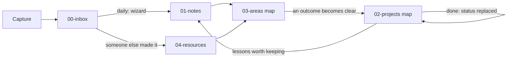

# Workflow guide

Step-by-step use of INPARA for bottom-up knowledge management. Placement and names come from the wizard in [ORGANIZE.md](ORGANIZE.md); this guide covers the rhythm.

## 1. Capture → Inbox (I)

**When**: immediately, whenever a thought, idea, insight or useful snippet occurs.
**What**: short notes, quick thoughts, screenshots, links, voice notes, code snippets, errors.
**How**: drop it in `00-inbox/` with whatever method is fastest.

## 2. Sort and write notes → Notes (N)

**When**: daily, ideally at the end of the day or in the morning.
**How**: run the wizard on each inbox item and take the first yes.

1. **Search first.** If a note on the subject exists, add to it. Never copy.
2. **Someone else made it?** Capture it in `04-resources/`, and write your own note about it in `01-notes/`.
3. **Your own idea?** Write an atomic note in `01-notes/01a-atomic/`: one idea, under Notes, Thoughts and Links ([template](templates/atomic-note.md)).
4. **Name it** by the slug of its title: `private-endpoint-dns-zone.md`, never `20250608T1540-...`.
5. **Link it** from at least one area or project map, with a reason. A note no map reaches is lost.

## 3. Grow maps → Areas (A)

**When**: weekly, or when a cluster of notes becomes obvious.
**What**: an area is one map note in `03-areas/`. When five or more notes share a subject, make or extend its map ([template](templates/area-map.md)).

The area map **is** the map of content: there is no separate maps folder.

## 4. Start projects → Projects (P)

**When**: a specific outcome or deliverable becomes clear from an area map.
**How**: write a project map `02-projects/<project>.md` ([template](templates/project-map.md)) that links the notes and resources it uses. Plans and logs go in `02-projects/<project>/`. Anything still useful after the project ends is a note, linked from the map.

## 5. Capture references → Resources (R)

**When**: you will consult something someone else made again.
**How**: capture it in `04p-pages/`, `04d-documents/` or `04r-repos/` ([template](templates/resource-capture.md)), and link it from a map.

## 6. Finish work → stays in place (A)

**When**: a project ends, or a note is superseded.
**How**: set `status: replaced` and say what replaced it. The file does not move, so no link breaks. Only something that arrives already finished, such as an old export, goes to `05-archive/`.

## Review cycles

### Daily (5 to 10 minutes)
- Empty the inbox with the wizard.
- Link each new note from a map.

### Weekly (30 to 45 minutes)
- Read the week's notes for patterns.
- Grow area maps; split a map that got too broad.
- Note potential projects in the area maps.

### Monthly (1 to 2 hours)
- Review project maps; mark finished ones `replaced` and write their outcome.
- Run the checks: no dead links, no orphans, no copies, every item on a map.

## Tips for success

1. **Start small.** Inbox, atomic notes and one area map are enough to begin.
2. **Be consistent.** Daily sorting matters more than perfect placement.
3. **Trust emergence.** Don't force maps or projects before they are ready.
4. **Let checks keep the lists honest.** Maps are written by hand; the checks catch what was missed.

The goal is sustainable knowledge building, not perfect organization.
